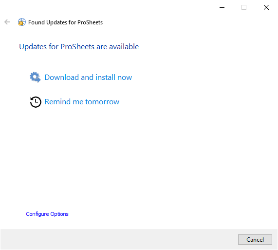

# Getting Started
{: .no_toc }

Use this guide to install, update, and uninstall ProSheets.
{: .fs-6 .fw-300 }

## Table of contents
{: .no_toc .text-delta }

1. TOC
{:toc}

---

## Download

Download the [latest version of ProSheets](https://diroots.com/revit-plugins/revit-to-pdf-dwg-dgn-dwf-nwc-ifc-and-images-with-prosheets/).


## Install

### Compatibility
- Revit 2018–2027.
- Use a Windows version supported by your Revit release. See [Autodesk's system requirements](https://www.autodesk.com/support/technical/article/caas/sfdcarticles/sfdcarticles/System-requirements-for-Autodesk-Revit-products.html).

### Prerequisites
- Admin permissions.
- PDF24 (the compatible version will be installed automatically. Don’t install it manually).

ProSheets is installed for all users on the machine. Its add-in files are stored in `%ProgramData%\Autodesk\Revit\Addins\`.
{: .note }

### Standard Installation

This method is intended for users with administrator permissions who want to install ProSheets on one computer.

1. Run ProSheets installer.

2. Select the Revit versions and click 'Install'.

   

3. Wait for the installation to complete and click 'Finish'.

   

4. Restart your computer to complete the installation.

### Silent Installation

This method is intended for IT administrators who want to deploy ProSheets to multiple computers.

- Install for all compatible Revit versions.

  ```cmd
  <installer-name>.exe /i // /qn accept_eula=1
  ```

- Disable automatic check for update (i.e., users won’t be prompted to install updates).

  ```cmd
  <installer-name>.exe /i // /qn accept_eula=1 UPDATER="FALSE"
  ```

- Exclude specific Revit versions.

  ```cmd
  <installer-name>.exe /i // /qn accept_eula=1 revit2018="" revit2019=""
  ```

- Skip PDF24 installation. You can export PDFs without PDF24 by using the native Revit PDF exporter in Revit 2022 or newer with a [ProSheets Premium license](https://diroots.com/revit-plugins/quote-request/).
  {: .warning }

  ```cmd
  <installer-name>.exe /i // /qn accept_eula=1 INSTALL_PDF24=""
  ```

## Uninstall

### Using the installer User Interface

1. Run ProSheets installer.

2. Select and click 'Remove'.

   

3. Wait for the uninstallation to complete, then click 'Finish'.

PDF24 is not removed when you uninstall ProSheets. Uninstall PDF24 separately if you no longer need it.
{: .note }

### Using the installer silently

Uninstall ProSheets without user interaction.

```cmd
<installer-name>.exe /x // /qn
```

### From the control panel

1. In the search box on the taskbar, type Control Panel and select it from the results.

2. Select Programs > Programs and Features.

3. Press and hold (or right-click) on the program you want to remove and select Uninstall or Uninstall/Change. Then follow the directions on the screen.

## Updates

ProSheets includes an updater to help you keep it up to date. 
The updater will:
- notify you whenever a new version is released (the action is triggered on Revit close event).
- ask you to install now or to remind you tomorrow.



### Updater Settings

The updater checks for updates every two days by default. You can change the frequency and download folder.

By default, update checks cannot be disabled in the updater settings. To check less often, set the frequency to 365 days.
{: .tip }

**Pro Tip for IT administrators:** To change how often ProSheets checks for updates across the machine, edit `%ProgramData%\ProSheets\Settings\updater.ini` and change `CheckFrequency=2` to `CheckFrequency=365`.
{: .tip }

We recommend keeping ProSheets up to date. Support is not provided for outdated versions.
{: .important }

<button class="btn js-toggle-dark-mode">Preview dark color scheme</button>
