# Create Tab
{: .no_toc }

## Table of contents
{: .no_toc .text-delta }

1. TOC
{:toc}

---

## User Interface Overview

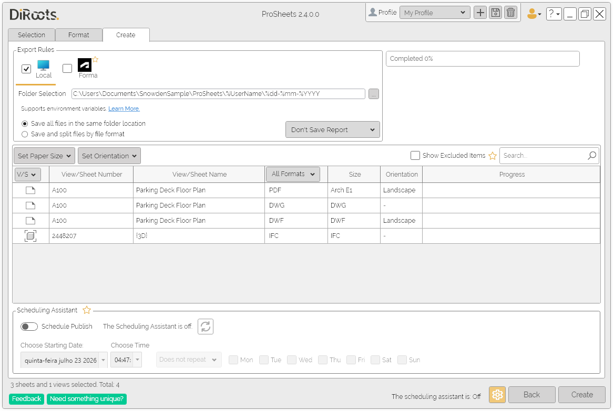  
Note: the version on the image may not reflect the [latest version of ProSheets](https://diroots.com/revit-plugins/revit-to-pdf-dwg-dgn-dwf-nwc-ifc-and-images-with-prosheets/).

## Export Location

ProSheets allows you to export files locally, to Autodesk Forma, or to both destinations in the same export job.

Use the checkboxes under "Export Rules" to select "Local", "Forma", or both. Select the corresponding tab to configure each export location. When both options are selected, ProSheets saves the generated files to the configured local folder and uploads them to the selected Forma folder in the same export job.

### Local

Use "Local" to export files to a folder on your computer or to a shared network drive.

Select the "Local" checkbox and open the "Local" tab. Use the "Folder Selection" field to enter the export path, or click the ellipsis button (...) to select a folder.

### Forma

ProSheets can export files to Autodesk Forma Document Management (premium feature). Select the option "Forma" and choose a Hub, Project, and folder from your Forma account as the export location.

#### Install and authorize the DiRoots Connector

Before ProSheets users can export files to an Autodesk Forma Hub (previously called an account), a Hub Administrator must install and authorize the DiRoots Connector for that Hub.

Steps for Hub Administrators:

1. Sign in to Autodesk Forma and open "Hub Admin" for the required Hub.
2. Open "Apps".
3. Select "DiRoots Connector for Autodesk Forma" from the App Gallery.
4. Click "Install".
5. Review the requested permissions, then click "Authorize and Install".

  

Install the connector separately for each Hub where ProSheets will be used. ProSheets users can then follow the steps below to log in to Forma.

Autodesk previously used the terms “account” and “Account Admin” for “Hub” and “Hub Admin”.
{: .note }

#### Login to Forma

Steps:

1. Select the "Forma" checkbox and open the "Forma" tab.
2. Click on "Login to Forma" and log in with your Autodesk account in the browser window.
3. Return to ProSheets.

After logging in, ProSheets will display the Forma Hubs and Projects available to your Autodesk account.

If a Hub is not available, contact your Hub Administrator to confirm that the DiRoots Connector has been added and that you have access to the Hub.

#### Folder selection

After logging in, select the Hub, Project, and folder where the exported files will be saved.

Steps:

1. Select a Hub from the dropdown list.
2. Select a Project from the dropdown list.
3. Click the ellipsis button (...) next to the folder path to open the Forma Explorer.
4. Browse the Autodesk Docs folder structure and select the destination folder.

The Forma Explorer allows you to expand and collapse folders and displays information such as name, version, last updated date, updated by, and description.

After selecting a folder, the Forma path will be displayed in the Create tab.

After ProSheets generates each export, it uploads the file to the selected Forma folder. If a file with the same name already exists, the upload creates a new version of the existing file.

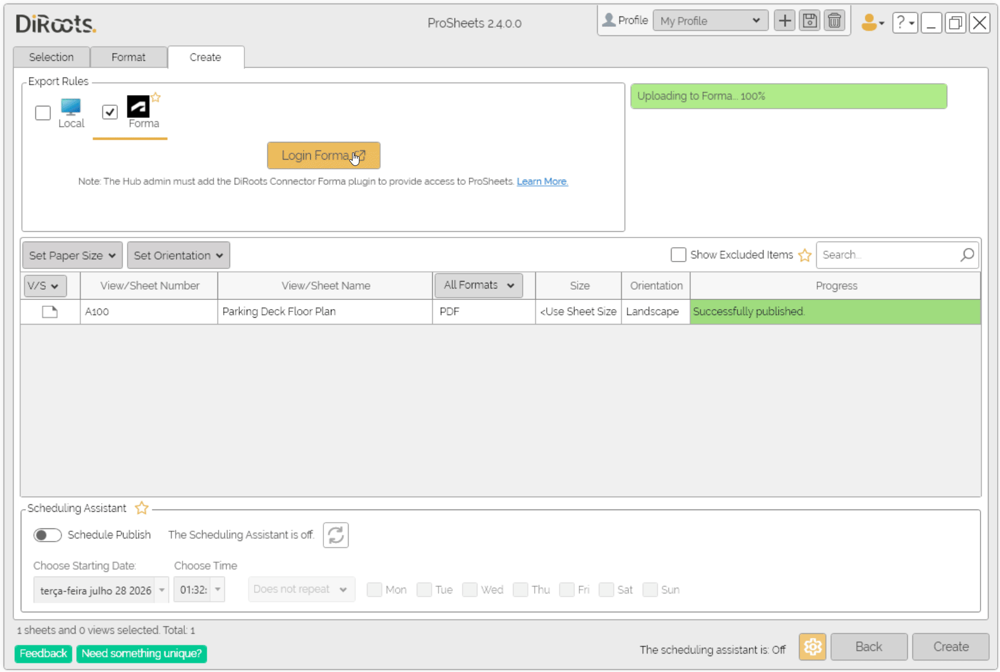  
Note: the version on the image may not reflect the [latest version of ProSheets](https://diroots.com/revit-plugins/revit-to-pdf-dwg-dgn-dwf-nwc-ifc-and-images-with-prosheets/).

#### Custom attributes mapping

ProSheets can fill the custom attributes of the selected Forma project with the values of Revit sheet parameters (premium feature), so each uploaded sheet carries your project data (for example a status, a revision code, or the name of the author).

Steps:

1. Select the Hub, Project, and folder as described above.
2. Click the gear button next to the folder path ("Map Revit parameters to Forma custom attributes") to open "Forma Attributes Mapping".
3. In the "Sheet parameter" column, choose the Revit sheet parameter that fills each custom attribute. Leave "(none)" for the attributes you don't want to fill.
4. Click "OK".

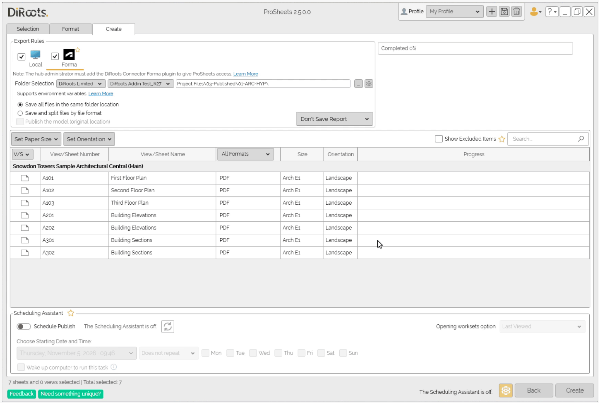  
Note: the version on the image may not reflect the [latest version of ProSheets](https://diroots.com/revit-plugins/revit-to-pdf-dwg-dgn-dwf-nwc-ifc-and-images-with-prosheets/).

ProSheets writes the values after each file is uploaded.

- Text, date, and drop-down list attributes can be mapped. Large drop-down lists cannot be mapped.
- For a drop-down list, the value must match one of the list options (upper and lower case are ignored). For a date, the value must be a valid date. Text values longer than 255 characters are not written.
- Empty parameter values are skipped. When a value cannot be written, the file is still uploaded. The export result says that some files were uploaded without their custom attribute values, and the ProSheets log gives the reason for each value that was not written.
- Each list in the "Sheet parameter" column shows only the parameters whose values on the selected sheets fit the attribute: dates for a date attribute, and values that all match the list options for a drop-down list.
- "Cannot be edited" is shown for an attribute that is not attached to the selected folder, and for a large drop-down list. To map an attribute that is not attached, attach it to the folder in Forma.
- Create the custom attributes in Forma first. If the project has none, ProSheets shows a message instead of opening "Forma Attributes Mapping".

Custom attribute values are written only to files that contain one sheet. They are not written to files that combine several sheets, or to files exported from views.
{: .note }

### Folder organization

Use the radio buttons to choose how ProSheets organizes the exported files.

- "Save all files in the same folder location" - saves all exported files in the selected folder.
- "Save and split files by file format" - creates a subfolder for each exported file format.

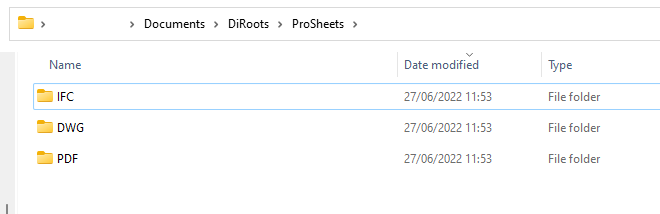  

### Publish the cloud model

When the Revit model is a cloud model in an ACC or Forma project, scheduled exports can also publish the model to its original location in Forma (premium feature).

Select "Publish the model (original location)". The option is shown below the folder organization options when the "Forma" tab is open, and is available after you log in to Forma. When the schedule runs, ProSheets asks Autodesk to publish the latest synchronized version of the main model. Synchronize your changes before the schedule runs. Linked models are not published. The result of the publication is shown in the result of the scheduled export and in the report.

The option requires an ACC/Forma cloud model and Revit 2022 or newer. BIM 360 projects are not supported. The option is saved with the schedule, and the model is published only by scheduled exports (see [Scheduling Assistant](#scheduling-assistant)), not by a manual export.
{: .note }

### Environment variables

You can use environment variables to build the saving path.

#### Supported environment variables:

- %UserName% - current Windows username
- %Y - the current year (e.g., 2024)
- %YY - the current year (e.g., 24)
- %YYYY - the current year (e.g., 2024)
- %m - the current month without padding zero (e.g., 6)
- %mm - the current month with padding zero (e.g., 06)
- %d - the current day without padding zero (e.g., 5)
- %dd - the current day with padding zero (e.g., 05)
- %H - the current hour without padding zero (e.g., 8)
- %HH - the current hour with padding zero (e.g., 08)
- %M - the current minute without padding zero (e.g., 1)
- %MM - the current minute with padding zero (e.g., 01)
- %S - the current seconds without padding zero (e.g., 4)
- %SS - the current seconds with padding zero (e.g., 04)
- %DrawingName% - the filename
- %IssueDate% - the Sheet Issue Date builtin parameter
- %CurrentRevision% - the Current Revision builtin parameter of the sheet
- %CurrentRevisionDate% - the Current Revision Date builtin parameter of the sheet

The date and time variables are case-sensitive. You can also use Windows environment variables, such as %APPDATA%.

To change the date format of %IssueDate% or %CurrentRevisionDate%, add the format of the value in Revit and the format you want, for example %IssueDate(dd.MM.yyyy, yyyy-MM-dd)%.

When sheets/views are combined into one file, %IssueDate%, %CurrentRevision%, and %CurrentRevisionDate% are left empty.

Local export example:

Input:  

C:\Users\Joao_\OneDrive - DiRoots Limited\Documents\DiRoots\ProSheets\ExportFiles\%UserName%-%Y-%m-%d-%H-%M-%S  

Output:  

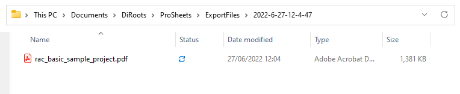

### Generate Export Report

Use the report dropdown to choose whether ProSheets generates a report after the export. The report can be generated in .XLSX (Excel spreadsheet) or .CSV (comma-separated values).

The same report option applies to Local and Forma exports.

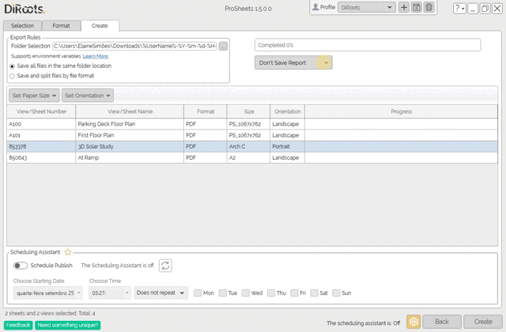  
Note: the version on the image may not reflect the [latest version of ProSheets](https://diroots.com/revit-plugins/revit-to-pdf-dwg-dgn-dwf-nwc-ifc-and-images-with-prosheets/).

Information included in the report:
- The files that were created: "View/Sheet Name", "Job", "Format", "File Name", "Size", "Local Path", "Forma Path" (Forma exports), "Export Time", and "Status" ("Successful" or "Error")
- "Total Export Time", "Date", "Job Started", and "Job Finished" of the export job
- The parameter columns you added (see [Add parameter columns to the report](#add-parameter-columns-to-the-report))
- For scheduled exports that publish the cloud model, the result of the publication (see [Publish the cloud model](#publish-the-cloud-model))

When the export includes linked models, the rows are grouped by model. In the Excel report, the "Status" cell is colored: green for a successful export, amber for a successful export with a warning (for example an empty file), and red for an error. The CSV report has no colors. The report uses the same language as ProSheets.

Example:
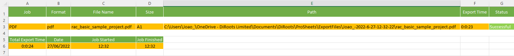  

#### Add parameter columns to the report

You can add sheet and view parameters as extra columns in the Excel or CSV report.

Steps:

1. Select "Save Report to Excel" or "Save Report to CSV". A gear button appears next to the report dropdown.
2. Click the gear button ("Add parameter columns to the report").
3. Select a parameter in the list of available parameters and click the arrow button to add it. Repeat for each parameter you need.
4. Click "OK".

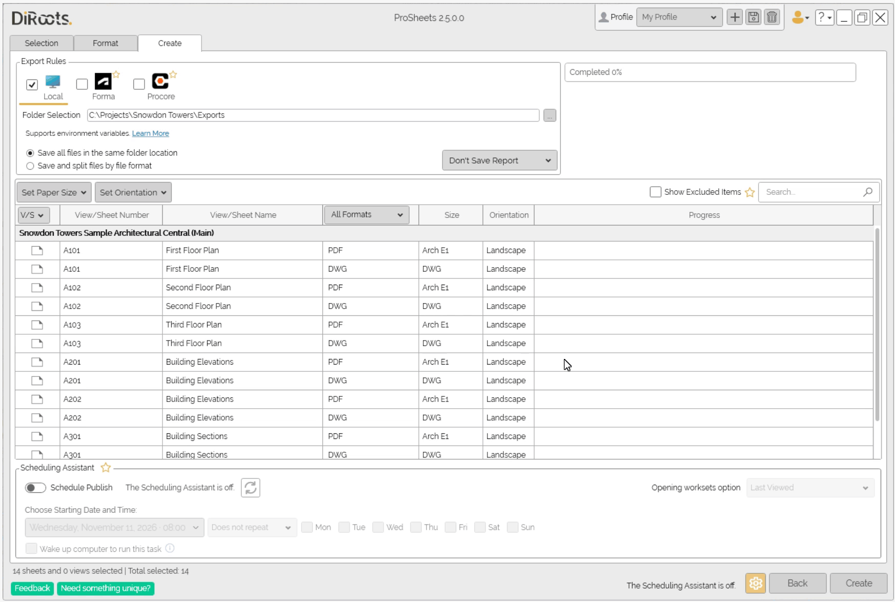  
Note: the version on the image may not reflect the [latest version of ProSheets](https://diroots.com/revit-plugins/revit-to-pdf-dwg-dgn-dwf-nwc-ifc-and-images-with-prosheets/).

## Manage the export queue

Use the search and filters in the Create tab to find rows in the export table without changing what ProSheets exports.

### Search

Enter part of a sheet or view number or name in the search field. ProSheets displays rows with matching values in the "View/Sheet Number" or "View/Sheet Name" columns.

### Filter views, sheets, and formats

Use the Views/Sheets (V/S) filter in the column header to display rows by item type:

- "All Views/Sheets": Displays both sheets and views.
- "Sheets": Displays only sheets.
- "Views": Displays only views.

Use the format filter to display rows for one file format. The dropdown includes only the formats selected in the Format tab. Select "All Formats" to clear the format filter.

You can combine the search, Views/Sheets, and format filters.

Filters only change which rows are displayed. Hidden items remain in the export queue and will still be exported. Remove an item from the queue to stop it from being exported.
{: .important }

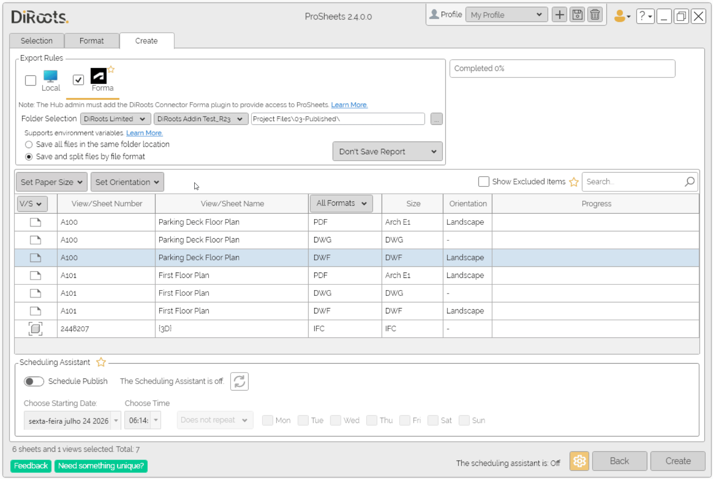  
Note: the version on the image may not reflect the [latest version of ProSheets](https://diroots.com/revit-plugins/revit-to-pdf-dwg-dgn-dwf-nwc-ifc-and-images-with-prosheets/).

### Exclude and restore export items

To exclude items from the export, select one or more rows, right-click the selection, and select "Remove item(s) from queue". Removed items are not exported.

"Show Excluded Items" is a Premium feature. When selected, the excluded items are shown in halftone. To add them back to the export queue, select them, right-click the selection, and select "Restore item(s) to queue". Restored items are included in the export again.

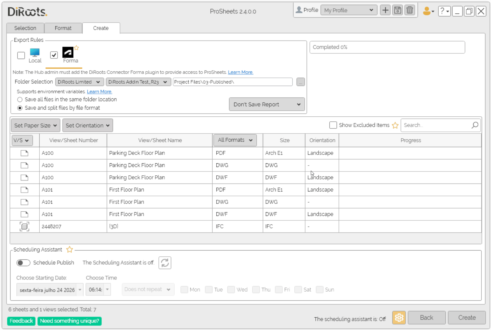  
Note: the version on the image may not reflect the [latest version of ProSheets](https://diroots.com/revit-plugins/revit-to-pdf-dwg-dgn-dwf-nwc-ifc-and-images-with-prosheets/).

## Paper Size and Orientation

By default, ProSheets automatically detects the paper size and orientation of your sheets. The detection uses the title block with the greatest width on the sheet (the built-in parameters Sheet Width and Sheet Height; the height decides between title blocks of the same width). A sheet is landscape when its width is equal to or greater than its height.

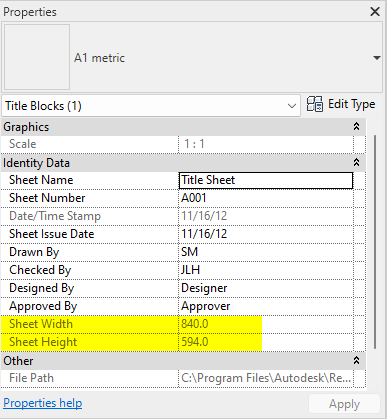  

### Manually set the Paper Size and Orientation

The auto-detection works in most cases, but you can also set a specific size and orientation.

Steps:
1. Select the sheets/views whose paper size and orientation you want to change.
2. Use the "Set Paper Size" and "Set Orientation" dropdown lists, or right-click the selection and select "Paper Size" or "Orientation".

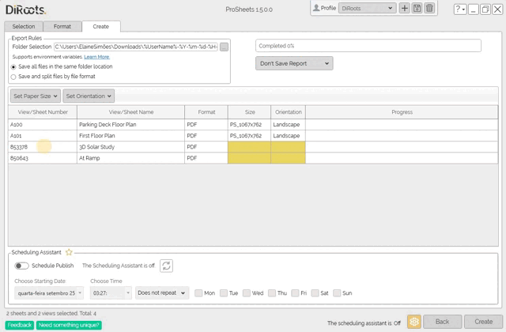  
Note: the version on the image may not reflect the [latest version of ProSheets](https://diroots.com/revit-plugins/revit-to-pdf-dwg-dgn-dwf-nwc-ifc-and-images-with-prosheets/).

Right-click a row and select "Open Sheet" or "Open View" to open it in Revit. This is not available for sheets and views from linked models.
{: .note }

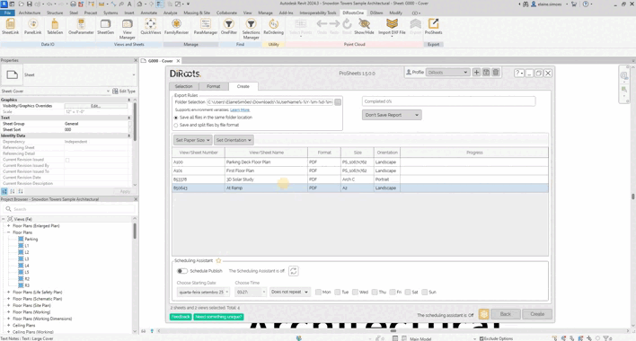  
Note: the version on the image may not reflect the [latest version of ProSheets](https://diroots.com/revit-plugins/revit-to-pdf-dwg-dgn-dwf-nwc-ifc-and-images-with-prosheets/).

## Export results and retry

Click "Create" to start the export. While ProSheets exports, the "Progress" column shows the result of each row: green for a successful export, orange for a successful export with a warning, and yellow for a failed export, with a note that explains the problem.

To stop the export, click "Cancel" and confirm with "Cancel export". Sheets already exported remain in the output folder.

When the export finishes, ProSheets shows "Export completed.", or "Export failed." if any row failed. After a Forma export without failed rows, it also says how many files were uploaded to Forma, or that some files were not uploaded. Use the buttons to continue:

- "Open Folder" - opens the output folder (Local exports).
- "Open Forma" - opens the Forma folder (Forma exports).
- "Retry" or "Retry Failed Publishes" - exports the failed rows again with the same settings. When a sheet/view of a combined file failed, the whole combined file is exported again.

You can also right-click the table in the Create tab and select "Retry Failed Publishes".

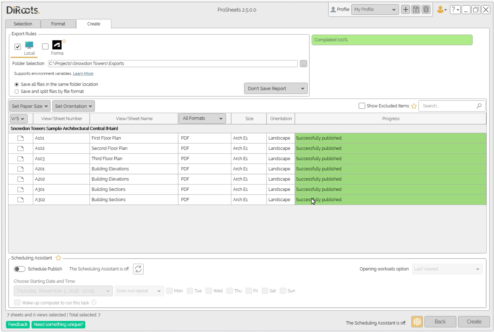  
Note: the version on the image may not reflect the [latest version of ProSheets](https://diroots.com/revit-plugins/revit-to-pdf-dwg-dgn-dwf-nwc-ifc-and-images-with-prosheets/).

---

## Scheduling Assistant

The Scheduling Assistant (premium feature) allows you to define the views/sheets and their settings to be exported and schedule the export at an exact date and time, or repeat it.

Scheduled exports run even when Revit is closed: ProSheets opens the model in a new Revit instance with the worksets you choose (see [Opening worksets option](#opening-worksets-option)). If the model is open in Revit when the schedule runs, ProSheets can export it in that session instead (see [Before and during a scheduled export](#before-and-during-a-scheduled-export)).
{: .note }

### Schedule Publish

Steps:

1. Switch on "Schedule Publish" in the Create tab.
2. Click the date and time field. In the calendar, under "Choose Starting Date and Time:", pick the date and the time, then click "Apply". Click "Undo changes" to go back to the previous date and time.
3. Use the repeat dropdown to define whether the export will be repeated: "Does not repeat", "Weekly", or "Monthly".
  - If you choose "Weekly", choose the days of the week on which the export runs.
  - Use the checkbox to select the days.

To stop the scheduled exports, switch off "Schedule Publish".

- Save the model before you schedule it. Revit Server models cannot be scheduled.
- For "Does not repeat", choose a date and time in the future. A time that has already passed is not accepted.
- The scheduled export opens the model in the Revit version in which you scheduled it. That Revit version must be installed on the computer.

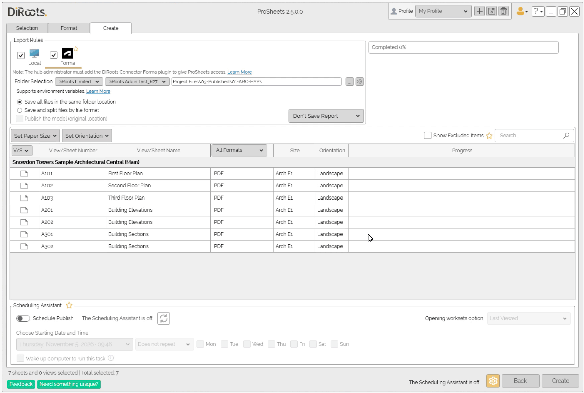  
Note: the version on the image may not reflect the [latest version of ProSheets](https://diroots.com/revit-plugins/revit-to-pdf-dwg-dgn-dwf-nwc-ifc-and-images-with-prosheets/).

### Opening worksets option
{: #opening-worksets-option }

For a workshared model, choose which worksets open when the scheduled export opens the model:

- "Last Viewed" (file-based central models only) - opens the worksets that were open when the central model was last saved or synchronized. If that leaves every workset closed, ProSheets opens all worksets.
- "All Worksets" - opens all worksets.
- "Specify" - click the gear button to open "Worksets to open" and select the worksets.

When the export runs in an open Revit session, the worksets that are open in that session are used. When ProSheets opens the model with "Specify" and none of its worksets is open (for example because the selected worksets were deleted), the export stops.
{: .note }

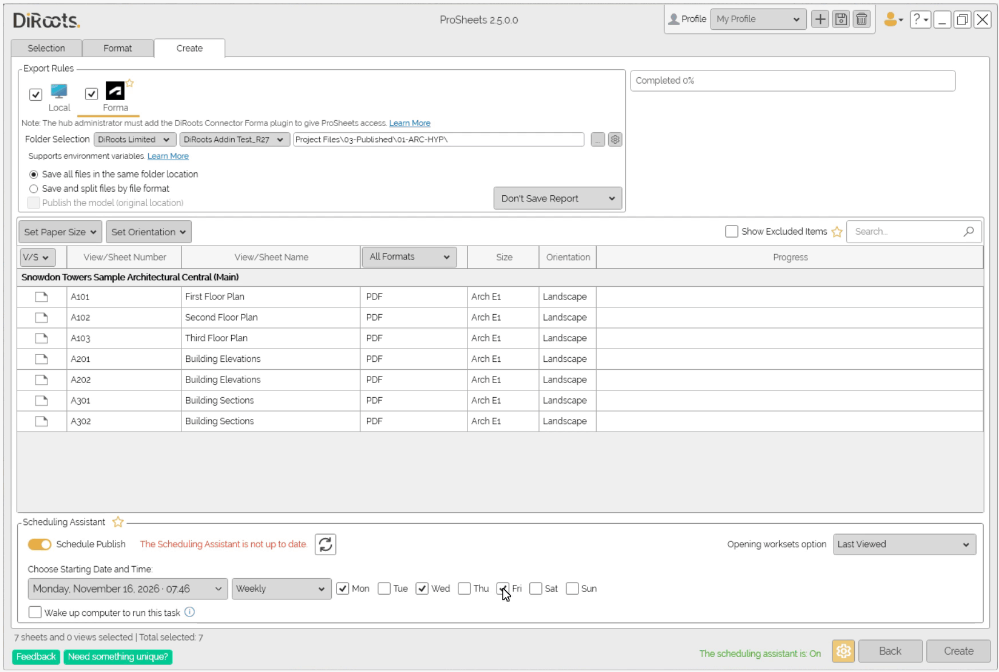  
Note: the version on the image may not reflect the [latest version of ProSheets](https://diroots.com/revit-plugins/revit-to-pdf-dwg-dgn-dwf-nwc-ifc-and-images-with-prosheets/).

### Linked models in scheduled exports

Sheets and views that you select from linked models (see [Export from linked models](selection-tab.html#export-from-linked-models)) are included in scheduled exports, so the main model and its links are exported together, unattended. When you select only sheets/views from linked models, the scheduled export opens the linked models without the main model, unless "Publish the model (original location)" is selected.

### Before and during a scheduled export

- By default, when you are signed in to Windows, ProSheets shows a 30-second countdown before a scheduled export starts. Click "Cancel" to skip this run, "Start now" to start it at once, or "Delay 10 min" to postpone it. After a delay, click "+10 min" to postpone it again.
- If the model is open in a Revit session, the export runs in that session as soon as the model is the active model and the session is not busy. By default, ProSheets waits up to 5 minutes for this and then exports in a new Revit instance. Click "Start new instance" to stop waiting. If the model is not open, the export starts in a new Revit instance at once.
- While the export runs, a progress window shows its progress. Click "Cancel" to stop the export. Sheets already exported remain in the output folder, and files already uploaded to Forma are not deleted.
- By default, a Windows notification reports the result when the export finishes.
- Before it exports, ProSheets checks that the opened model is the model you scheduled. If it is not, the export stops. Open the model in ProSheets, check it, and update the schedule.
- After a scheduled export, ProSheets checks each exported file. A missing file gets the status "Error". An empty file keeps the status "Successful" with a warning, shown in amber in the Excel report. A file that cannot be checked (for example on a network folder that is not available) keeps its status.

### Wake up computer to run this task
{: #wake-up-computer-to-run-this-task }

This option asks Windows to wake the computer from Sleep or Hibernate for a scheduled export. Windows settings and your computer's configuration may prevent it from waking or running the task.

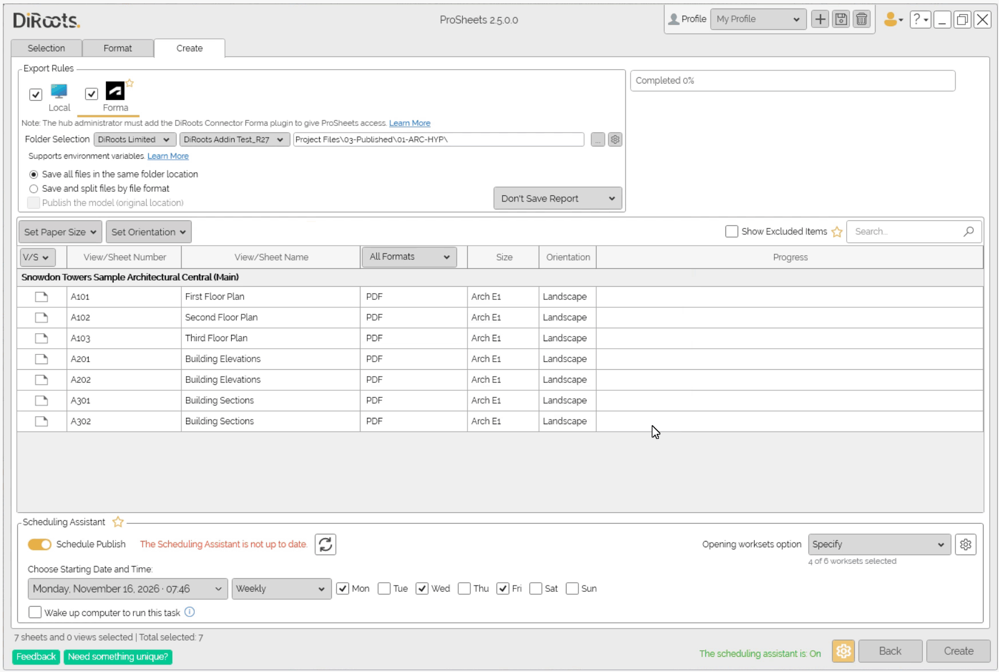  
Note: the version on the image may not reflect the [latest version of ProSheets](https://diroots.com/revit-plugins/revit-to-pdf-dwg-dgn-dwf-nwc-ifc-and-images-with-prosheets/).

- **Wake timers:** In Control Panel, go to **Hardware and Sound > Power Options > Change plan settings > Change advanced power settings > Sleep > Allow wake timers**. Set the applicable **On battery** and **Plugged in** values to **Enable**. **Important Wake Timers Only** allows Windows system timers to wake the computer, but does not allow a ProSheets scheduled export to wake it. If you cannot change them, contact your IT administrator.
- **Modern Standby:** Scheduled exports may not run while the computer is asleep. Use **Hibernate**, keep the computer plugged in, and set the plugged-in sleep timeout to **Never**. If Hibernate is unavailable, contact your IT administrator.
- **Computer or account unavailable:** The task cannot run if the computer is shut down or the scheduling account is signed out.

### Scheduling Assistant Legend

The bottom bar of ProSheets shows whether the Scheduling Assistant is on. On the Selection tab, the refresh button next to it reloads the list of sheets and views and clears the selection. It does not update the schedule.

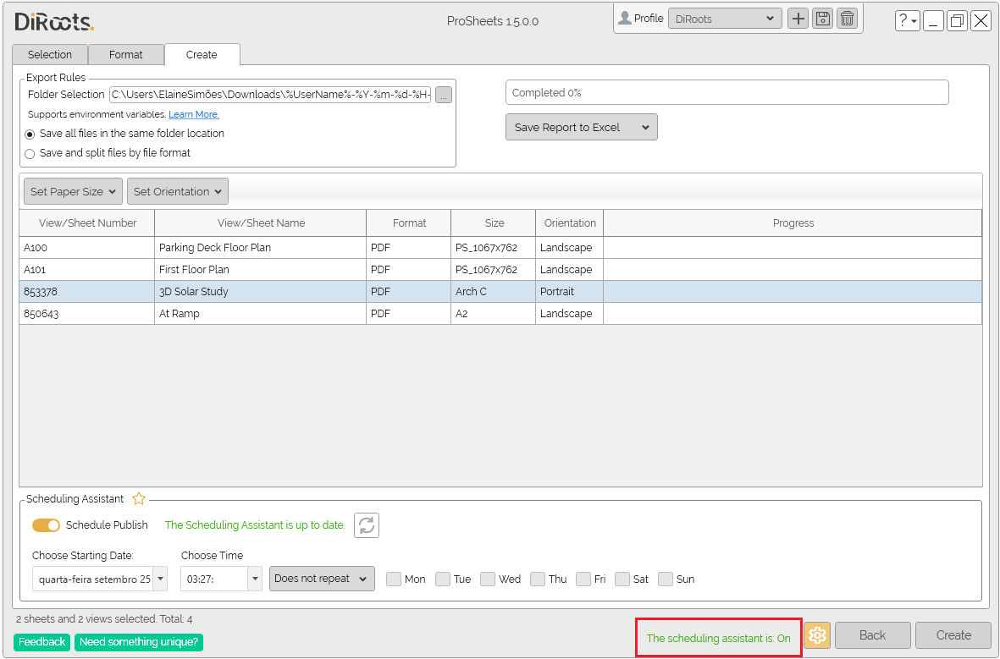  
Note: the version on the image may not reflect the [latest version of ProSheets](https://diroots.com/revit-plugins/revit-to-pdf-dwg-dgn-dwf-nwc-ifc-and-images-with-prosheets/).

#### Scheduling Assistant Status

When you switch on the Scheduling Assistant, it saves the current settings with the schedule. The status in the Create tab shows:

- "The Scheduling Assistant is off."
- "The Scheduling Assistant is up to date." - the schedule uses your current settings.
- "The Scheduling Assistant is not up to date." - you changed settings after the schedule was saved. The scheduled export keeps using the saved settings until you update it.

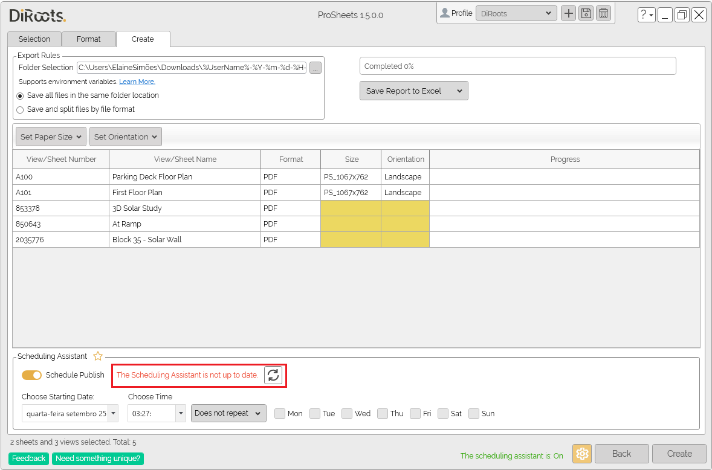  
Note: the version on the image may not reflect the [latest version of ProSheets](https://diroots.com/revit-plugins/revit-to-pdf-dwg-dgn-dwf-nwc-ifc-and-images-with-prosheets/).

#### Scheduling Assistant Update

Whenever the Scheduling Assistant is not up to date, the update button next to the status becomes active. Click it to see a report of the changes. Click "Update" to save the changes to the schedule, or "Cancel" to keep the saved schedule.

If you close ProSheets while the Scheduling Assistant is not up to date, ProSheets asks whether to close without updating. If you close, your changes are not saved to the schedule, and the schedule keeps running with its saved settings.

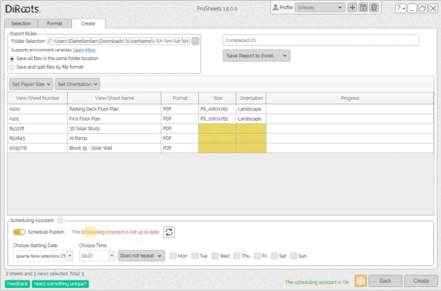  
Note: the version on the image may not reflect the [latest version of ProSheets](https://diroots.com/revit-plugins/revit-to-pdf-dwg-dgn-dwf-nwc-ifc-and-images-with-prosheets/).

---

If you want to find out more about ProSheets and explore detailed tutorials on how to use it, visit our YouTube channel. There, you'll find a series of videos that can help answer questions and improve your knowledge. Be sure to check it out and subscribe to keep up to date with our news and tips!

[DiRoots Channel](https://www.youtube.com/@DiRootsNews){: .btn .btn-di-orange }
