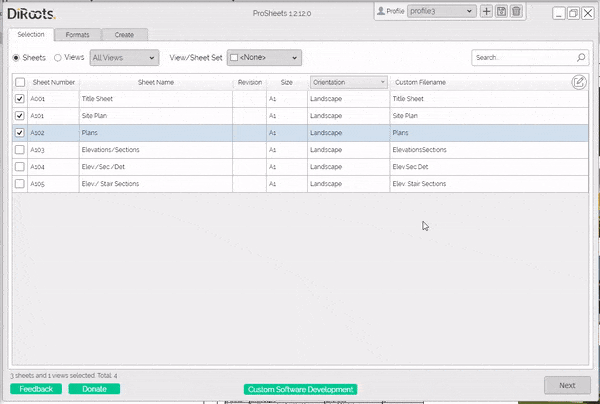
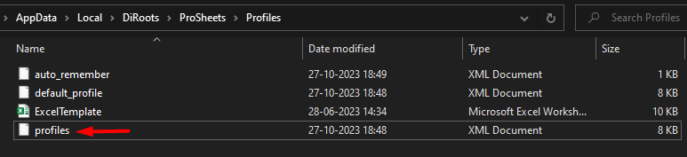
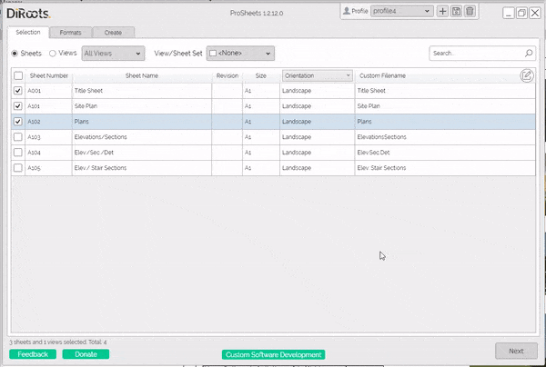
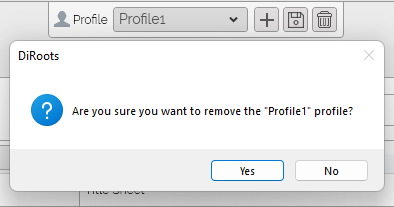

# Profiles
{: .no_toc }

## Table of contents
{: .no_toc .text-delta }

1. TOC
{:toc}

---

## What's saved in the profile

The following settings are saved in the profiles.
- Naming rules
- Export settings (for PDF, DWG, DGN, DWF, NWC, IFC, and Images)

## Creating Profiles

ProSheets profiles make it easy to save your settings and reuse them later. It is also a handy way for BIM Managers to create standard rules (e.g., filename conventions) and share them across the organization.

Steps:
1. In the window header, click on the plus (+) button next to the profiles list.
2. Name the profile (give it a meaningful name because this is the name that will show up in the profiles list)
3. Choose if you want to create a profile with the default ProSheets settings, with your current settings, or import settings from an existing profile.
4. Click on the "Create" button to create the profile.

  
Note: the version on the image may not reflect the [latest version of ProSheets](https://diroots.com/revit-plugins/revit-to-pdf-dwg-dgn-dwf-nwc-ifc-and-images-with-prosheets/).

**Tip for BIM managers:** Save profiles in a shared network location so other users can import them. See [Importing Profiles](#importing-profiles) for the steps.
{: .tip }

## Use the profile as default

Once you have saved your profiles with the necessary practice settings, you can also add this profile as default to all teams. Follow the steps:

1. Create a profile into ProSheets.
2. Open the following location path %localappdata%\DiRoots\ProSheets\Profiles.
3. Copy the Profile file from the current location.
4. Replace it on all users' machines.

The profile will now be immediately visible to users.

  
Note: the version on the image may not reflect the [latest version of ProSheets](https://diroots.com/revit-plugins/revit-to-pdf-dwg-dgn-dwf-nwc-ifc-and-images-with-prosheets/).

## Importing Profiles

ProSheets profiles make it easy to import existing profiles to stay compliant with your company standards (e.g., profiles in a network location).

Steps:
1. In the window header, click on the plus (+) button next to the profiles list.
2. Choose "Import from file(s)" to import settings from one or more existing profiles.
3. Click the "..." button and use the Windows File Explorer to find the profile files (e.g., in a shared folder, a network location, or your local computer). You can select several files; ProSheets creates one profile for each file.
4. Check the profile name. ProSheets fills it in with the file name, or with `<File Name>` when you select several files. Change it if needed; this is the name that will show up in the profiles list.
5. Click on the "Create" button to create the profiles.

When you import several files, keep `<File Name>` in the profile name to name each profile after its file (for example, `Office - <File Name>`). Without it, the profiles are numbered.
{: .tip }

ProSheets asks before overwriting an existing profile with the same name. Files that cannot be read are skipped, and the reasons are displayed.

When ProSheets loads a profile, it checks that the profile's settings can be applied, for example a setting that your Revit version or this version of ProSheets does not support. Any settings that could not be applied are listed in "Profile settings that could not be applied", together with what was used instead. Scheduled exports run the same check.

  
Note: the version on the image may not reflect the [latest version of ProSheets](https://diroots.com/revit-plugins/revit-to-pdf-dwg-dgn-dwf-nwc-ifc-and-images-with-prosheets/).

## Deleting Profiles

Steps:
1. In the window header, select the from the dropdown the profile you want to delete
2. Click on the dustbin icon next to the profiles list.
3. Confirm.

  