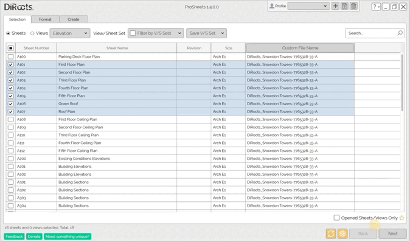
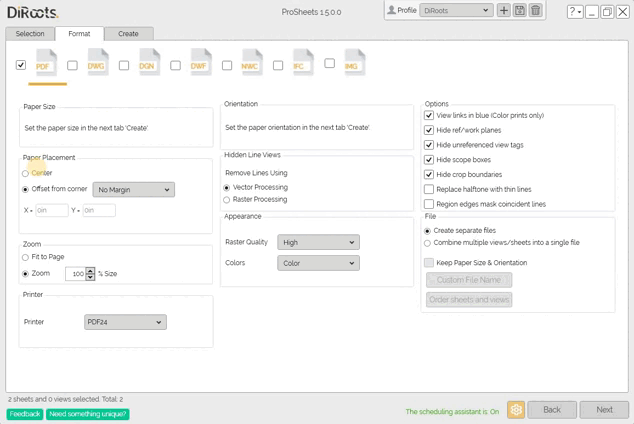
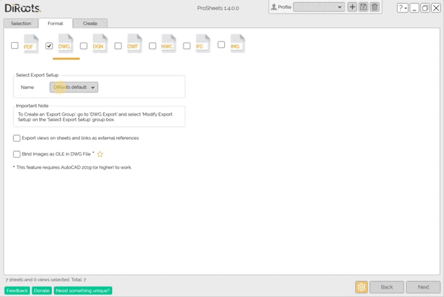
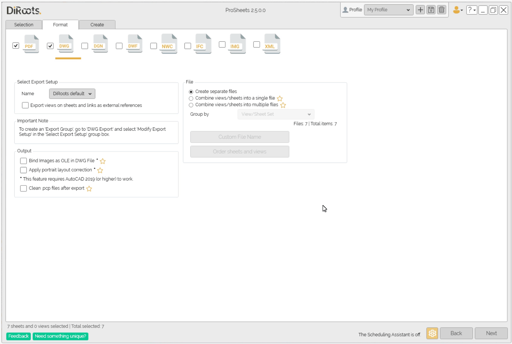
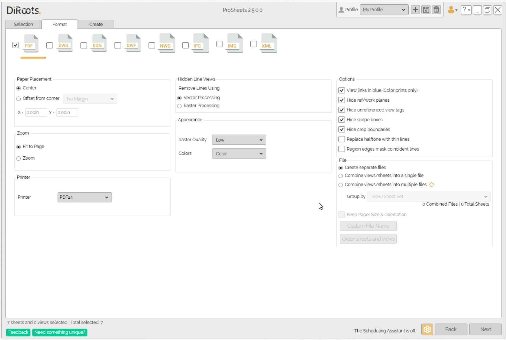
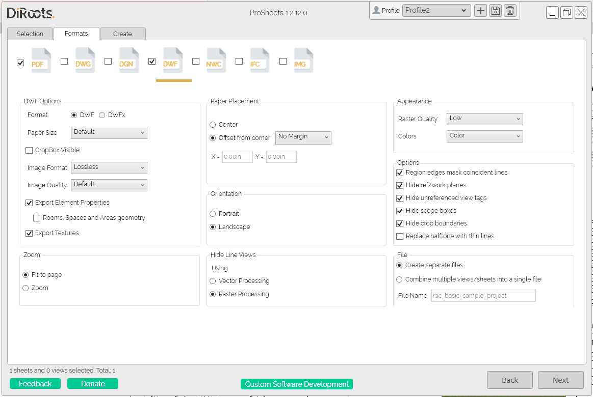
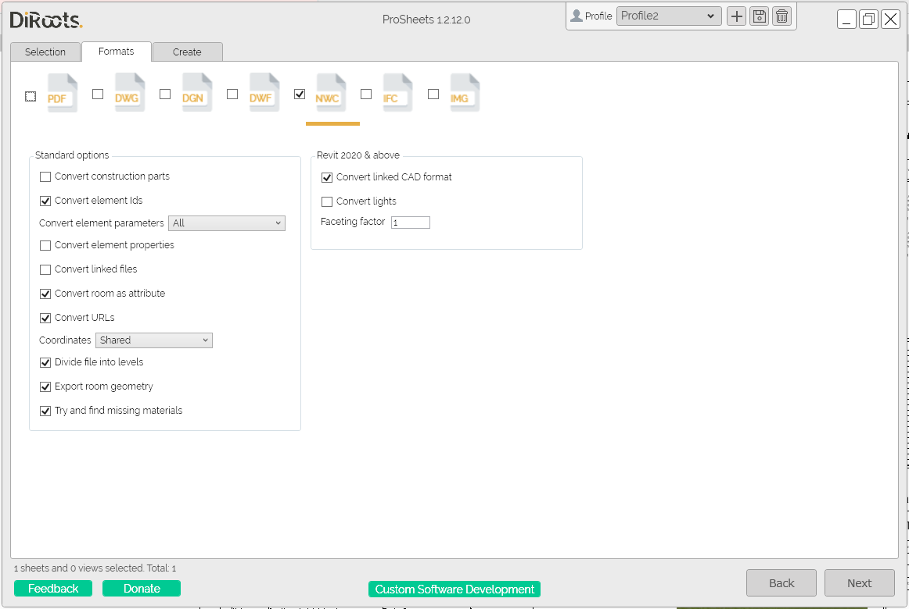
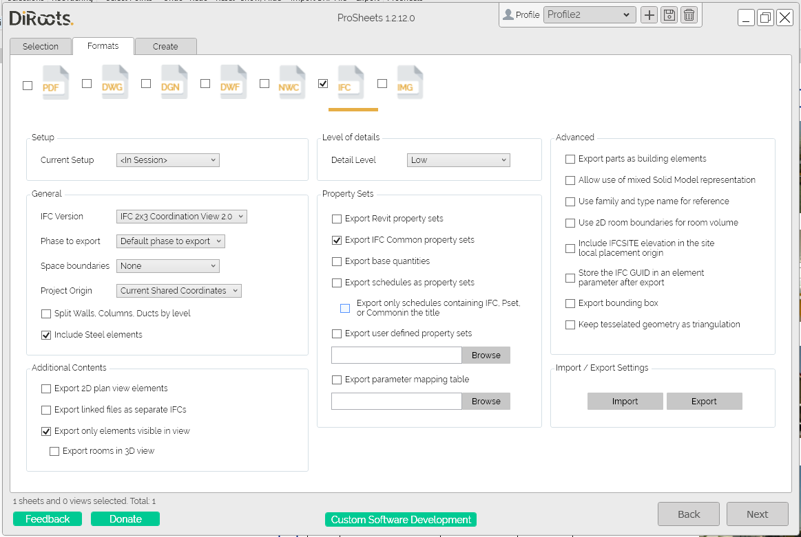
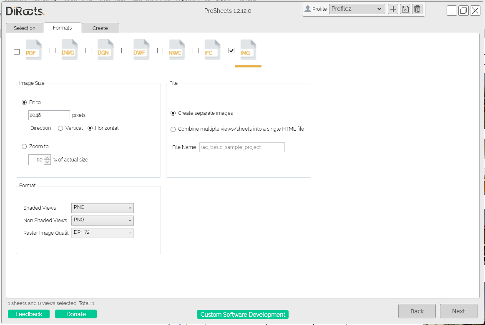
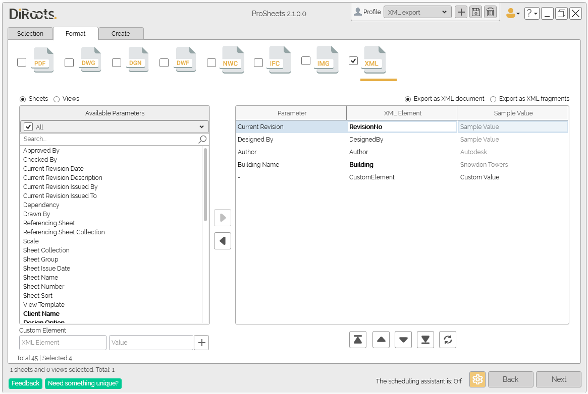

# Formats Tab
{: .no_toc }

## Table of contents
{: .no_toc .text-delta }

1. TOC
{:toc}

---

## Supported File Formats

ProSheets allows you to batch Export Sheets/Views to PDF, DWG, DGN, DWF, NWC, IFC, IMG (BMP, JPEG, PNG, TARGA, TIFF) and XML.

  
Note: the version on the image may not reflect the [latest version of ProSheets](https://diroots.com/revit-plugins/revit-to-pdf-dwg-dgn-dwf-nwc-ifc-and-images-with-prosheets/).

## PDF Settings

ProSheets uses the Revit engine and a custom instance of PDF24 printer (diroots.prosheets printer) to export to PDF. ProSheets supports all Revit to PDF options plus some additional handy features. In Revit 2022 and newer, ProSheets can also export with the native Revit PDF exporter (premium feature).

Supported settings:

- **All PDF Revit settings**
    - Paper Size: set the paper size in the "Create" tab.
    - Paper Placement: choose to locate the print in the "Center" or assign an X and Y value to the "Offset from Corner".
    - Zoom: choose the zoom for printing by selecting "Fit to page" or by setting a % value for "Zoom".
    - Printer: choose the printer you want, either the "PDF24" used as standard by ProSheets or "Revit Native" (premium feature, Revit 2022 and newer). With "Revit Native", use "Export Setup" to export with the current session settings or with one of the PDF export setups saved in the project. A saved setup fills in "Paper Placement", "Zoom", "Hidden Line Views", "Appearance", "Options", and the choice between separate files and a single combined file. These settings cannot be changed in ProSheets while the setup is selected.
    - Orientation: set the orientation in the "Create" tab.
    - Hidden Line Views: use the radio button to remove lines using "Vector Processing" or "Raster Processing".
    - Appearance: choose the "Raster Quality" and the "Colors" ("Color", "Grayscale", or "Black Lines").
    - Options: use the checkbox to select some of the general settings you want.
    - File: choose whether each sheet/view is saved as a separate file or combined with others (see [Combine sheets and views into PDF files](#combine-sheets-and-views-into-pdf-files)).

  
Note: the version on the image may not reflect the [latest version of ProSheets](https://diroots.com/revit-plugins/revit-to-pdf-dwg-dgn-dwf-nwc-ifc-and-images-with-prosheets/).

### Combine sheets and views into PDF files

In the "File" group, choose how ProSheets saves the sheets/views:

- "Create separate files" - one PDF file for each sheet/view.
- "Combine views/sheets into a single file" - one PDF file with all the selected sheets/views.
- "Combine views/sheets into multiple files" (premium feature) - one PDF file for each group of sheets/views, for example one file for each View/Sheet Set. Below the options, ProSheets shows how many combined files it will create and how many sheets they contain.

Steps:
1. Select "Combine views/sheets into multiple files".
2. In "Group by", choose how the sheets/views are grouped: "View/Sheet Set", "Sheet Collection" (Revit 2025 and newer), "Sheet Group", or any other sheet or view parameter.
3. Click "Custom File Name" to name the files. The "Group by" parameter is added to the file name, so each file is named after its group.
4. Click "Order sheets and views" to set the order of the pages. In "Order by", choose the parameter to sort by, or set your own order: select rows and move them with the arrow buttons below the list, or drag them. When you group by View/Sheet Set, "Set's Print Order" (Revit 2023 and newer) keeps the order of each set in Revit.
5. Click "OK".

- Sheets/views with no value for the "Group by" parameter are combined in a group named "Ungrouped". When you group by View/Sheet Set, selected sheets/views that are not in any of the sets also go to "Ungrouped".
- A sheet/view that belongs to more than one set is added to the file of each set. When you select sets in "Filter by V/S Sets" on the Selection tab, only those sets are used; otherwise all sets are used.
- Sheets/views from different models are never combined in the same file. ProSheets creates the combined files separately for the main model and for each linked model.

  
Note: the version on the image may not reflect the [latest version of ProSheets](https://diroots.com/revit-plugins/revit-to-pdf-dwg-dgn-dwf-nwc-ifc-and-images-with-prosheets/).

#### Paper size and orientation of combined files

- In Revit 2023 and newer, select "Keep Paper Size & Orientation" to keep the paper size and orientation of each sheet in the combined file. Otherwise, all the pages of a combined file use the paper size and orientation of its first sheet. With PDF24, a combined file created with this option does not support "Jump to Section".
- In Revit 2022 and older, select "Keep jump to section" to keep Revit's "Jump to Section" links in the combined file. All the pages then have the same size, and the sheets/views cannot be reordered. In Revit 2022 with "Revit Native", this option is not available, and the sheets/views of a combined file cannot be reordered.

## DWG Settings

ProSheets uses the Revit engine to export to DWG. All the DWG settings will be read from the DWG export setups created in Revit.

Steps:
1. In Revit UI go to File -> Export -> DWG and create a new DWG/DXF export setup as per your requirements (if you don't know how to create/modify a DWG/DXF setup, read this [article](https://help.autodesk.com/cloudhelp/2026/ENU/Revit-DocumentPresent/files/GUID-E8443B4B-D55B-4630-BEE3-D2D8628CA17B.htm))

2. Use the dropdown to switch between the existing DWG setups. If you created the setup with ProSheets opened, you may need to close and reopen it to see the new setup in the list.

3. Select the checkbox to "Export views on sheets and links as external references".

4. Use the checkbox to "Bind Images as OLE in DWG File" (premium feature).

5. Use the checkbox to "Apply portrait layout correction" (premium feature). Revit exports portrait sheets with a landscape layout; this option keeps them portrait.

6. In the "File" group, choose how the views/sheets are saved:
   - "Create separate files" - one DWG file for each sheet/view.
   - "Combine views/sheets into a single file" (premium feature) - one DWG file, with each sheet as a layout.
   - "Combine views/sheets into multiple files" (premium feature) - one DWG file for each value of the parameter you choose in "Group by", for example one file for each sheet issue date. ProSheets shows how many files it will create.

   For combined files, use "Custom File Name" to name the files and "Order sheets and views" to set the order of the layouts.

To create an export group, open **DWG Export** and select **Modify Export Setup** in the **Select Export Setup** group.
{: .note }

In Revit 2019 and newer, the DWG settings also include "Bind Images as OLE in DWG File" and the "File" group, and "Apply portrait layout correction" works only in Revit 2019 and newer. Binding images, correcting portrait layouts and combining DWG files require AutoCAD 2019 or later.
{: .note }

  
Note: the version on the image may not reflect the [latest version of ProSheets](https://diroots.com/revit-plugins/revit-to-pdf-dwg-dgn-dwf-nwc-ifc-and-images-with-prosheets/).

  
Note: the version on the image may not reflect the [latest version of ProSheets](https://diroots.com/revit-plugins/revit-to-pdf-dwg-dgn-dwf-nwc-ifc-and-images-with-prosheets/).

## DGN Settings

ProSheets uses the Revit engine to export to DGN. All the DGN settings will be read from the DGN export setups created in Revit.

Steps:
1. In Revit UI go to File -> Export -> DGN and create a new DGN export setup as per your requirements (if you don't know how to create/modify a DGN setup, read this [article](https://help.autodesk.com/cloudhelp/2026/ENU/Revit-DocumentPresent/files/GUID-253B99CA-09C0-456E-B260-E69F5C14F793.htm))
2. Use the dropdown to switch between the existing DGN setups. If you created the setup with ProSheets opened, you may need to close and reopen it to see the new setup in the list.

  
Note: the version on the image may not reflect the [latest version of ProSheets](https://diroots.com/revit-plugins/revit-to-pdf-dwg-dgn-dwf-nwc-ifc-and-images-with-prosheets/).

## DWF Settings

ProSheets uses the Revit engine to export to DWF/DWFx.

Supported settings:

- Format: "DWF" or "DWFx".
- DWF Options: "Export Element Properties", "Rooms, Spaces and Areas geometry", "Export Textures", "Image Format" and "Image Quality".
- Paper Placement, Zoom, Hidden Line Views ("Remove Lines Using"), Appearance and Options: the same settings as for PDF.
- File: "Create separate files" or "Combine views/sheets into a single file".

  
Note: the version on the image may not reflect the [latest version of ProSheets](https://diroots.com/revit-plugins/revit-to-pdf-dwg-dgn-dwf-nwc-ifc-and-images-with-prosheets/).

## NWC Settings

ProSheets uses the Autodesk Navisworks NWC Export Utility to export to NWC. You must install the [Autodesk Navisworks NWC Export Utility](https://www.autodesk.com/products/navisworks/3d-viewers) (if it's not yet installed).

The NWC settings include "Type properties on Elements" and "Separate Custom properties". Due to a Revit limitation, changes to these two settings do not affect further NWC exports in the current Revit session. Restart Revit for the changes to take effect.

  
Note: the version on the image may not reflect the [latest version of ProSheets](https://diroots.com/revit-plugins/revit-to-pdf-dwg-dgn-dwf-nwc-ifc-and-images-with-prosheets/).

## IFC Settings

ProSheets uses the Revit engine to export to IFC. The IFC settings are grouped in the same tabs as in Revit: "General", "Additional Contents", "Property Sets", "Level of Detail" and "Advanced".

When Revit has loaded and activated Autodesk's open-source IFC exporter, ProSheets uses it and offers its IFC versions and saved setups.

In Revit 2025 and newer, the IFC settings also include "Export Ceiling Grids" and, for IFC4x3, "Facility Type". "Facility Predefined Type" appears only for facility types that have predefined types.

  
Note: the version on the image may not reflect the [latest version of ProSheets](https://diroots.com/revit-plugins/revit-to-pdf-dwg-dgn-dwf-nwc-ifc-and-images-with-prosheets/).

## Images and HTML Settings

ProSheets uses the Revit engine to export to Images and HTML.

Supported settings:

- Image Size: "Fit to" a number of pixels in the "Horizontal" or "Vertical" direction, or "Zoom to" a % of actual size.
- File type for "Shaded Views" and "Non Shaded Views": BMP, JPEG (Lossless, Medium or Smallest), PNG, TARGA or TIFF.
- "Raster Image Quality".
- File: "Create separate images" or "Combine multiple views/sheets into a single HTML file".

  
Note: the version on the image may not reflect the [latest version of ProSheets](https://diroots.com/revit-plugins/revit-to-pdf-dwg-dgn-dwf-nwc-ifc-and-images-with-prosheets/).

## XML Settings

ProSheets uses the selected Sheets and Views parameters to build an XML document or fragment. It also supports Project Information parameters, environment variables (such as Date and Time), and custom Elements. A default XML element name is created from the parameter name, but it can be overridden.

  
Note: the version on the image may not reflect the [latest version of ProSheets](https://diroots.com/revit-plugins/revit-to-pdf-dwg-dgn-dwf-nwc-ifc-and-images-with-prosheets/).

---

Let's move on to the next step. After defining the formats you want, click on "Next" to go to the create settings.
