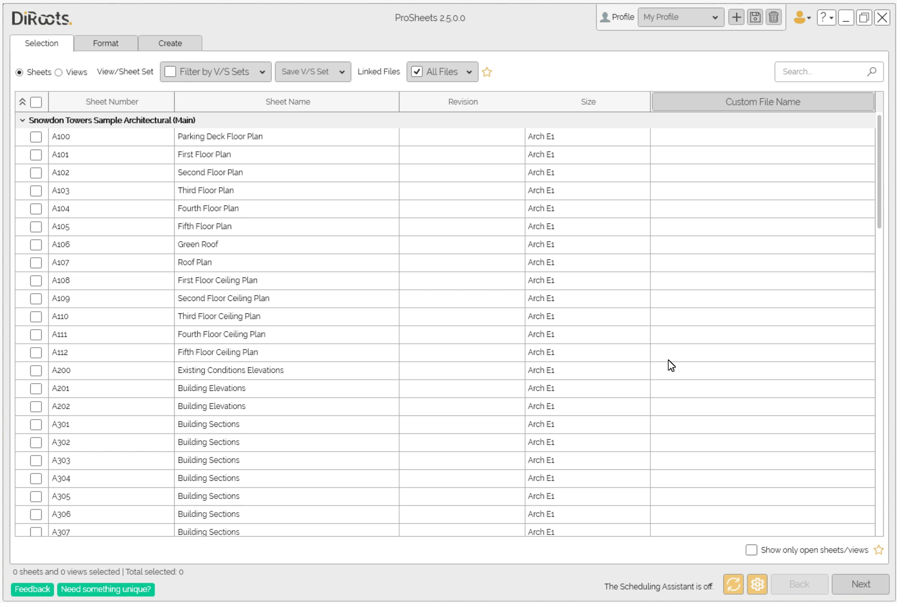
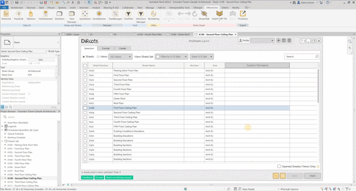
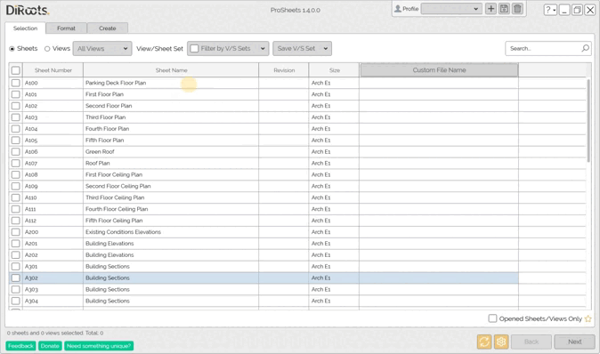
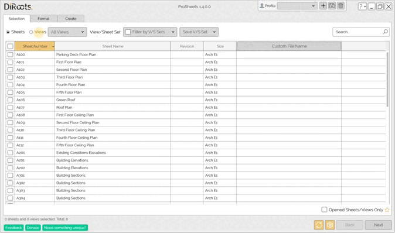
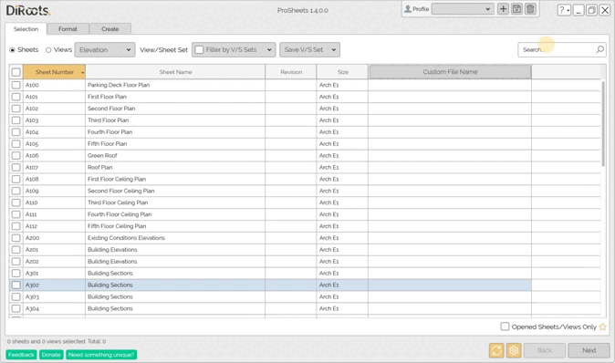
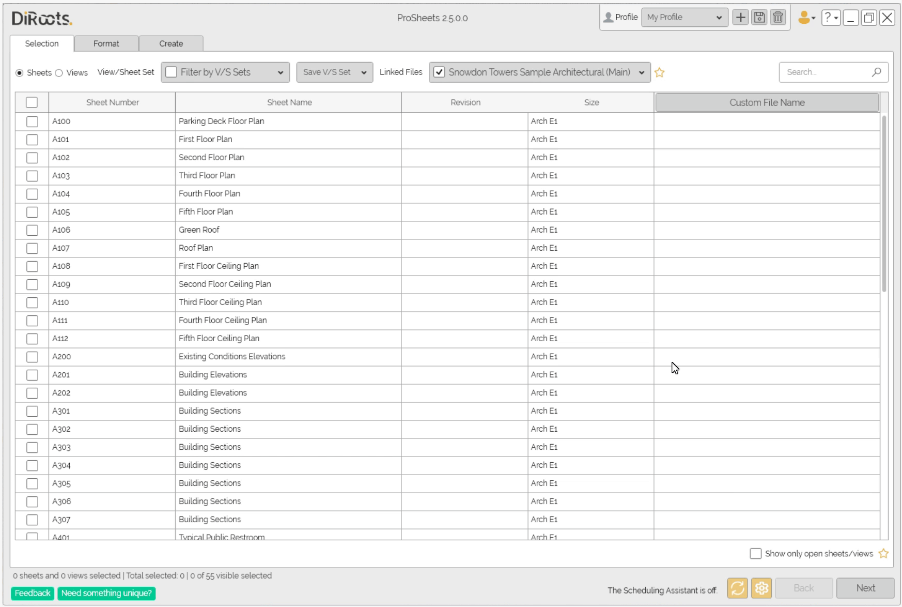
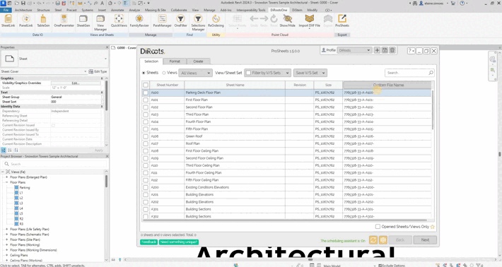
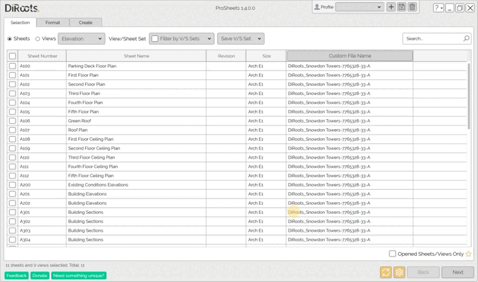

# Selection Tab
{: .no_toc }
The Selection tab is where you'll select the sheets and views to be exported and the file naming rules. ProSheets has options to sort, filter, and search to ease the selection. Plus, it has an advanced naming rule builder that allows you to customize the filenames.
## Table of contents
{: .no_toc .text-delta }

1. TOC
{:toc}

---

## Select Sheets and Views or View/Sheet Sets

The first step is to select the sheets and views to be exported.  

Steps:

1. Click the radio buttons to switch between sheets and views.

   - The 'Sheets' radio button shows the existing sheets in the project.
   - The 'Views' radio button shows the existing views in the project.

2. Use the checkboxes to select specific sheets/views or use the checkbox in the table header to select all the sheets/views that match the current filters and search, including rows in collapsed model groups.

    
   Note: the version on the image may not reflect the [latest version of ProSheets](https://diroots.com/revit-plugins/revit-to-pdf-dwg-dgn-dwf-nwc-ifc-and-images-with-prosheets/).

3. Select the "Show only open sheets/views" option (premium feature) to show only the sheets and views that are open in Revit.

    
   Note: the version on the image may not reflect the [latest version of ProSheets](https://diroots.com/revit-plugins/revit-to-pdf-dwg-dgn-dwf-nwc-ifc-and-images-with-prosheets/).

---

### Add Parameters columns

Right-click on the table header to select any other instance parameter available on your sheets. Examples - Current Review Date, Approved By, Appears on Sheet List, etc. 

  
Note: the version on the image may not reflect the [latest version of ProSheets](https://diroots.com/revit-plugins/revit-to-pdf-dwg-dgn-dwf-nwc-ifc-and-images-with-prosheets/).

### Filter

Filtering options available:

1. Dropdown to filter by view type (e.g., 3D, Floor Plan, Section, Detail, etc.).

    
   Note: the version on the image may not reflect the [latest version of ProSheets](https://diroots.com/revit-plugins/revit-to-pdf-dwg-dgn-dwf-nwc-ifc-and-images-with-prosheets/).

2.  Select several sheets/views and use "Save V/S Set" to save them as a new set. Use "Filter by V/S Sets" to show only the sheets/views of the sets you choose. Choosing a set filters the list; it does not select the sheets/views.

    
   Note: the version on the image may not reflect the [latest version of ProSheets](https://diroots.com/revit-plugins/revit-to-pdf-dwg-dgn-dwf-nwc-ifc-and-images-with-prosheets/).

### Search

The search box will search for text contained in any of the existing columns (including the customizable column). Click the clear (X) button in the search box to clear the search.  
  
---

For example, you can find Sheets by:
- Sheet Number
- Sheet Name
- Revision
- Size (e.g., A1, A0, etc.)
- Any instance parameter available in the customizable column
- Custom filename

---

For example, you can find Views by:
- View Name
- Scale
- Detail Level
- Discipline
- Custom filename

  
Note: the version on the image may not reflect the [latest version of ProSheets](https://diroots.com/revit-plugins/revit-to-pdf-dwg-dgn-dwf-nwc-ifc-and-images-with-prosheets/).

---

## Export from linked models

ProSheets can export sheets and views from the Revit models linked into the main model (premium feature), together with the main model's own sheets and views, without manually opening each model.

Steps:

1. Open the "Linked Files" dropdown and choose the models to list: "All Files", or select the main model and the linked models you need.
2. Click the arrow on a model's header to collapse or expand its sheets/views. When more than one model is selected in "Linked Files", the list is grouped by model, and the main model is marked "(Main)".
3. Use the checkboxes to select the sheets/views to export from any of the models.

  
Note: the version on the image may not reflect the [latest version of ProSheets](https://diroots.com/revit-plugins/revit-to-pdf-dwg-dgn-dwf-nwc-ifc-and-images-with-prosheets/).

- When you combine sheets/views into one file, ProSheets creates a combined file for each linked model.
- Sheets and views from linked models cannot be saved in a View/Sheet Set.
- The linked models must be loaded and available. A linked cloud model needs you to be signed in to your Autodesk account.
- Scheduled exports can include linked models (see [Linked models in scheduled exports](Create-tab.html#linked-models-in-scheduled-exports)).

For some exports ProSheets has to close the main model to export from its linked models: NWC, IFC, and image exports, linked models with nested links or a link back to the main model, and all exports in Revit 2020 and older. Before a manual export, ProSheets asks first. Nothing is saved, so any unsaved changes are lost. Keep "Reopen the file after exporting" selected to open the main model again when the export is done. When an export requires closing the main model, that model must have a saved location so ProSheets can reopen it.
{: .important }

---

## Custom File Name

The custom file name builder allows you to quickly set how you want your files to be named.

Main features:
- Parametric filenaming (using Sheet/View and Project Information parameters)
- Set custom field separators (e.g., SheetName-SheetNumber_Rev1)
- Custom Prefix and Suffix
- Other non-Revit parameters (e.g., Current Month, Day, Hour, etc.)
- Custom Name Preview

  
Note: the version on the image may not reflect the [latest version of ProSheets](https://diroots.com/revit-plugins/revit-to-pdf-dwg-dgn-dwf-nwc-ifc-and-images-with-prosheets/).

---

## Clear selection

Quickly clear the current selection.

---

## Advanced Settings

Set some advanced settings as defaults for your prints, using the radio button to set the desired setting.

1. Temporary Hide/Isolate

   - Turn off the Temporary Hide/Isolate mode before printing
   - Keep the Temporary Hide/Isolate mode on and print

2. Worksharing Display

   - Turn off the Worksharing Display mode before printing
   - Keep the Worksharing Display mode on and print

3. Reveal Hidden Elements

   - Turn off the Reveal Hidden Elements mode before printing
   - Keep the Reveal Hidden Elements mode on and print

4. Reveal Constraints

   - Turn off the Reveal Constraints mode before printing
   - Keep the Reveal Constraints mode on and print

5. Ribbon Tab Placement

   - "ProSheets": place ProSheets in its own tab
   - "DiRootsOne": place ProSheets inside the DiRootsOne tab

   Changes apply after restarting Revit.

    
   Note: the version on the image may not reflect the [latest version of ProSheets](https://diroots.com/revit-plugins/revit-to-pdf-dwg-dgn-dwf-nwc-ifc-and-images-with-prosheets/).

---

Let's move on to the next step. After selecting the sheets/views you want, click on "Next" to go to the format settings.
