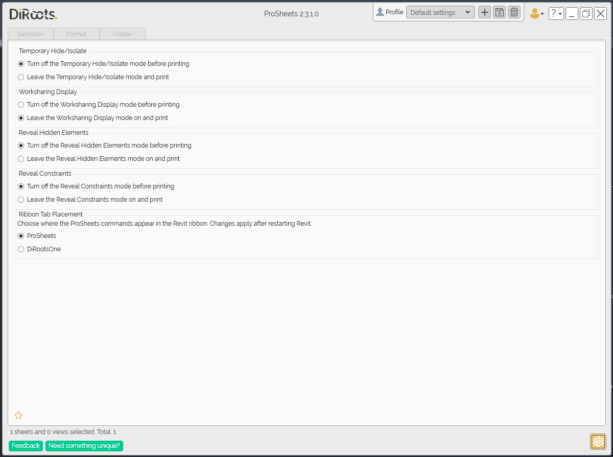

# Settings
{: .no_toc }

Use Settings to choose which Revit display modes stay on when you print and where ProSheets appears in the Revit ribbon.
{: .fs-6 .fw-300 }

To open Settings, go to the [Create tab](Create-tab.html#user-interface-overview) and click the gear icon at the bottom right, next to **Back**. Click the gear again to return to the Create tab.

## Table of contents
{: .no_toc .text-delta }

1. TOC
{:toc}

---

## Print options

For each display mode below, choose whether ProSheets turns it off before printing or leaves it on.

- Temporary Hide/Isolate
- Worksharing Display
- Reveal Hidden Elements
- Reveal Constraints

## Ribbon tab placement

- **ProSheets** places the commands in their own tab.
- **DiRootsOne** places the commands in the DiRootsOne tab.

Restart Revit to apply the change.
